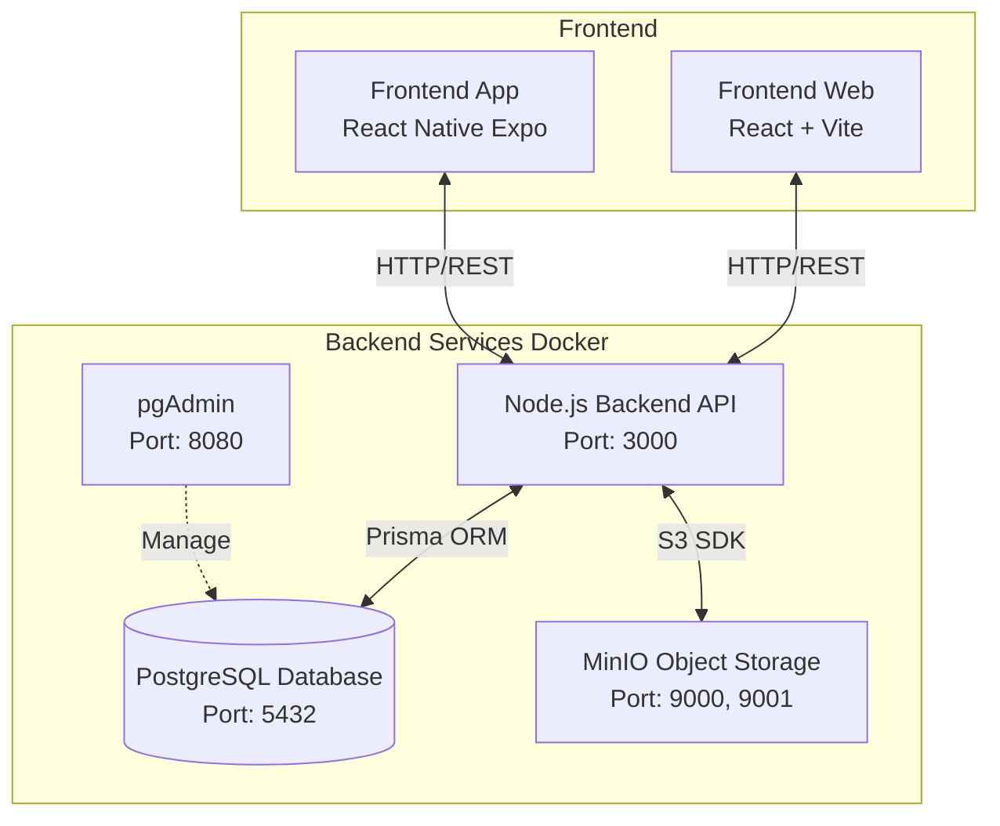

# 🚀 CRM In-App - คู่มือการติดตั้งฉบับละเอียด (Detailed Installation Guide)

ยินดีต้อนรับสู่โปรเจกต์ **CRM In-App** เอกสารนี้จัดทำขึ้นเพื่ออธิบายขั้นตอนการติดตั้งโปรเจกต์อย่างละเอียดแบบ Step-by-Step ตั้งแต่การเตรียมเครื่องมือไปจนถึงการทดสอบรันแอปพลิเคชันให้สามารถใช้งานได้ครบทุกส่วน

---

## 🏗️ โครงสร้างสถาปัตยกรรม (Architecture Diagram)
โปรเจกต์นี้มีส่วนประกอบที่ทำงานร่วมกัน 3 ระบบหลัก ได้แก่:



---

## 🛠️ ขั้นตอนที่ 1: การเตรียมเครื่องมือ (Prerequisites)
ก่อนที่คุณจะเริ่มโคลนโปรเจกต์และรัน ให้ตรวจสอบให้แน่ใจว่าเครื่องคอมพิวเตอร์ของคุณมีซอฟต์แวร์เหล่านี้ติดตั้งอยู่:

1. **Node.js** (เวอร์ชัน 18 ขึ้นไป): ใช้รันคำสั่งสำหรับ Frontend และแอปพลิเคชัน
   - ตรวจสอบโดยใช้คำสั่ง: `node -v` และ `npm -v`
2. **Docker Desktop** (หรือ Docker Engine + Docker Compose): ใช้สำหรับการสร้าง Database, MinIO, และ Server
   - ตรวจสอบโดยใช้คำสั่ง: `docker -v` และ `docker-compose -v`
3. **Git**: สำหรับดึงไฟล์โปรเจกต์ (ถ้ายังไม่มี)
4. **Expo Go** (สำหรับมือถือ): โหลดแอป Expo Go ลงในโทรศัพท์มือถือ iOS หรือ Android เพื่อใช้สแกนเปิดแอปพลิเคชัน

---

## 📥 ขั้นตอนที่ 2: การดาวน์โหลดโปรเจกต์ (Git Clone)
1. เปิด Terminal หรือ Command Prompt
2. รันคำสั่งโคลนโปรเจกต์ (เปลี่ยน `<repo-url>` เป็น URL จริงของโปรเจกต์):
   ```bash
   git clone <repo-url>
   cd CRM_In-App
   ```

---

## ⚙️ ขั้นตอนที่ 3: ตั้งค่าตัวแปรสภาพแวดล้อม (.env)
โปรเจกต์นี้มีระบบที่ต้องใช้ Environment Variables (ไฟล์ `.env`) จำนวน 3 จุดหลักๆ ได้แก่ Root (สำหรับ Docker), Frontend Web, และ Frontend App

### 3.1 ตั้งค่า Root Environment (สำหรับ Docker & Backend)
1. คัดลอกไฟล์ `.env.example` แล้วเปลี่ยนชื่อไฟล์ใหม่ให้เป็น `.env` ในโฟลเดอร์นอกสุด
2. เปิดไฟล์ `.env` ขึ้นมาแก้ไขข้อมูลที่สำคัญ เช่น รหัสผ่าน หรือเก็บไว้ตามค่าเริ่มต้นก็ได้:
   ```env
   # ตัวอย่างใน .env
   POSTGRES_USER=postgres
   POSTGRES_PASSWORD=your_strong_password   # แก้ไขรหัสผ่านฐานข้อมูลที่ต้องการ
   POSTGRES_DB=stage_base_crm
   
   JWT_SECRET=your_super_secret_jwt_key     # ใส่ข้อความอะไรก็ได้ที่เดายาก
   
   MINIO_ROOT_USER=minioadmin
   MINIO_ROOT_PASSWORD=your_minio_password  # แก้ไขรหัสผ่าน MinIO
   ```

### 3.2 ตั้งค่า Frontend Web Environment
1. เข้าไปที่โฟลเดอร์ `frontend-web`
2. หากยังไม่มีไฟล์ `.env` ให้สร้างไฟล์ใหม่ชื่อ `.env`
3. ตรวจสอบให้มั่นใจว่าตั้งค่า API URL ให้ชี้มาที่ Backend:
   ```env
   VITE_API_BASE=http://localhost:3000
   ```

### 3.3 ตั้งค่า Frontend App Environment (สำหรับแอปมือถือ)
1. เข้าไปที่โฟลเดอร์ `frontend-app`
2. สร้างหรือแก้ไขไฟล์ `.env` ให้มีตัวแปรชี้ไปที่ Backend (ถ้ารันทดสอบบนมือถือจริงที่ต่อ Wi-Fi เดียวกัน ต้องใช้ **IP Address ของเครื่องคอมพิวเตอร์** ของคุณแทน `localhost`)
   ```env
   # ตัวอย่างสำหรับรันในวงแลนเดียวกัน
   EXPO_PUBLIC_API_HOST_IOS=http://<IP_เครื่องคุณ>:3000
   EXPO_PUBLIC_API_HOST_ANDROID=http://<IP_เครื่องคุณ>:3000
   EXPO_PUBLIC_API_HOST_DEVICE=http://<IP_เครื่องคุณ>:3000
   ```

---

## 🐳 ขั้นตอนที่ 4: เริ่มต้นฐานข้อมูลและ Backend (รันผ่าน Docker)
ในขั้นตอนนี้เราจะสั่งให้ Docker สร้างกล่อง (Container) สำหรับ Database, MinIO, pgAdmin และ Backend ของเรา 

1. เปิด Terminal กลับมาที่โฟลเดอร์หลักของโปรเจกต์
2. พิมพ์คำสั่ง:
   ```bash
   docker-compose up -d --build
   ```
3. รอจนกว่าระบบจะ Build เสร็จ คุณสามารถเข้าใช้งาน Service ต่างๆ ได้ดังนี้:
   - **Backend API**: `http://localhost:3000`
   - **pgAdmin (จัดการ Database)**: `http://localhost:8080`
   - **MinIO Console**: `http://localhost:9001`

*(ข้อมูลเพิ่มเติม: Backend จะทำการรันคำสั่ง `npx prisma migrate deploy` ให้อัตโนมัติในตอนเปิด Container เพื่อสร้างตารางในฐานข้อมูล)*

---

## 🗄️ ขั้นตอนที่ 5: การจัดการ Database ด้วย Prisma (Migration & Seed)
เมื่อระบบ Backend เริ่มทำงานแล้ว ฐานข้อมูลจะว่างเปล่า เราจำเป็นต้อง Seed ข้อมูลตั้งต้นเข้าไป (ข้อมูลตัวอย่าง เช่น ผู้ใช้ บทบาทต่างๆ และอสังหาริมทรัพย์)

**การรัน Seed ข้อมูล (ใส่ข้อมูลตั้งต้น):**
ให้รันคำสั่งผ่าน Container ของ Backend ที่กำลังทำงานอยู่ด้วยคำสั่งนี้ที่ Root โฟลเดอร์:
```bash
docker exec -it CRM_in-app-backend npx prisma db seed
```
หาก Seed สำเร็จ ระบบจะแสดงข้อความว่าสร้างบัญชีตั้งต้นเรียบร้อยแล้ว

**การรัน Migration ด้วยตัวเอง (กรณีมีการแก้ไข Prisma Schema):**
หากคุณแก้ไขไฟล์ `schema.prisma` แล้วต้องการอัปเดตฐานข้อมูลขณะที่ระบบกำลังทำงาน:
```bash
docker exec -it CRM_in-app-backend npx prisma migrate dev
```

---

## 🔑 บัญชีผู้ใช้งานเริ่มต้น (Default Initial Accounts)
หลังจากที่ทำการ Seed ข้อมูลฐานข้อมูล (ตามขั้นตอนที่ 5) คุณสามารถใช้บัญชีเหล่านี้ในการล็อกอินเข้าสู่ระบบได้ทันที:

| บทบาท (Role) | อีเมล (Email) | รหัสผ่าน (Password) |
|---|---|---|
| **ADMIN** (ผู้ดูแลระบบสูงสุด) | `admin@crm.com` | `AdminPassword123!` |
| **MANAGER** (ผู้จัดการฝ่ายขาย) | `manager@crm.com` | `ManagerPassword123!` |
| **SALE** (พนักงานขาย) | `sale@crm.com` | `SalePassword123!` |
| **CUSTOMER** (ลูกค้า) | `customer@crm.com` | `CustomerPassword123!` |

---

## 💻 ขั้นตอนที่ 6: เริ่มรันแอปพลิเคชันส่วนเว็บไซต์ (Frontend Web)
1. เปิดหน้าต่าง Terminal ขึ้นมาใหม่แล้วเข้าไปที่โฟลเดอร์เว็บไซต์:
   ```bash
   cd frontend-web
   npm install
   npm run dev
   ```
2. นำ URL ที่แสดงบน Terminal (เช่น `http://localhost:5173`) ไปเปิดในเบราว์เซอร์ และล็อกอินด้วยบัญชีที่ให้ไว้ด้านบน

---

## 📱 ขั้นตอนที่ 7: เริ่มรันแอปพลิเคชันบนมือถือ (Frontend App)
1. เปิดหน้าต่าง Terminal ขึ้นมาใหม่อีกหน้าต่างแล้วเข้าไปที่โฟลเดอร์แอปมือถือ:
   ```bash
   cd frontend-app
   npm install
   npm start
   ```
2. เมื่อคำสั่งทำงานสำเร็จ จะมี **QR Code** ปรากฏขึ้นมาบน Terminal
   - **สำหรับ iOS**: เปิดแอปกล้องสแกน QR Code แล้วกดเปิดผ่านแอป "Expo Go" (หรือกดปุ่ม `i` ใน Terminal เพื่อเปิดบน Simulator)
   - **สำหรับ Android**: ใช้แอป "Expo Go" เพื่อ Scan QR Code (หรือกดปุ่ม `a` ใน Terminal เพื่อเปิดบน Emulator)

---

## 🔍 การตรวจสอบการทำงานด้วย Docker Logs
หาก Backend หรือระบบใดๆ ไม่ตอบสนอง คุณสามารถตรวจสอบข้อผิดพลาด (Error) ได้โดยการดู Logs ของ Docker:

**ดู Logs ของทุก Service แบบ Real-time:**
```bash
docker-compose logs -f
```

**ดู Logs เฉพาะ Backend:**
```bash
docker logs CRM_in-app-backend -f
```

*(กด `Ctrl+C` เพื่อออกจากหน้าดู Logs)*

---

## 🆘 การแก้ไขปัญหาเบื้องต้น (Troubleshooting)
1. **Port in use (Port ชนกัน)**
   - หากขึ้น Error ว่า Port มีการใช้งานอยู่แล้ว ให้เข้าไปเปลี่ยนพอร์ตในไฟล์ `.env` หรือใน `docker-compose.yaml`
2. **Frontend App เชื่อมต่อ API ไม่ได้**
   - ตรวจสอบ `frontend-app/.env` ว่าใส่ **IP Address ในวงแลน** แทน `localhost` ครบหรือไม่ (เช่น `192.168.1.xxx`) เพราะมือถือจะมองหา Server ในตัวมันเอง ไม่ได้มองหาคอมพิวเตอร์ของคุณ
3. **ต้องการหยุดการทำงานของ Docker**
   - พิมพ์คำสั่ง: `docker-compose down` (ใน Root โฟลเดอร์)
